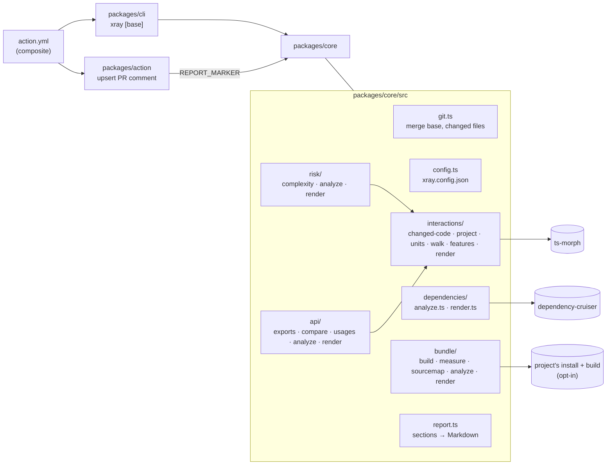

# Architecture

How xray is built. It explains *how* things work. The rules that follow from it are in
[principles.md](principles.md), the reasons for each choice in
[decisions.md](decisions.md), the security surface in [security.md](security.md), and open
work in [tasks.md](tasks.md). When code and this file disagree, the code is right and this
file is a bug.

## Shape

An npm workspaces monorepo in TypeScript (ESM, `NodeNext`), Node 24. It ships as:

- **`@xray/core`**: a library. Entry point `analyzePullRequest({ cwd, base })` → `XrayResult`;
  `renderMarkdown(result)` → the report.
- **`@xray/cli`**: the `xray [base]` binary (`packages/cli/src/index.ts`, commander).
- **`@xray/quality`**: the `xray-quality` binary and library: whole-repository scores
  ([ADR-0014](docs/adr/0014-project-quality-tool.md)), built on core's exports.
- **`@xray/quality-ui`** (private): a static React + Vite app on pulp that opens quality reports.
- **A composite GitHub Action** (`action.yml` at the repo root) that builds the workspace in
  `github.action_path`, runs the CLI and calls `packages/action/dist/index.js` to post the comment.

## Modules

| Path | Owns |
|---|---|
| `packages/core/src/git.ts` | Resolving the merge base (`<base>` or `origin/<base>`), the changed files and changed line ranges (diff to the working tree + untracked files, relative to the analysed folder), and file contents on the base |
| `packages/core/src/config.ts` | `xray.config.json` loading and defaults (`roots`, `tsConfig`, `exclude`, `dependencies.*`, `interactions.*`) |
| `packages/core/src/dependencies/` | Analysis 1: cruise the project, keep changed modules + direct neighbours, render the Mermaid flowchart |
| `packages/core/src/workspaces.ts` | Workspace discovery (`pnpm-workspace.yaml`, `workspaces`) and mapping package names and subpath exports to files, for both analyses (CI has no `node_modules`) |
| `packages/core/src/interactions/project.ts` | Loading the ts-morph project: the root tsconfig, or every workspace package at a workspace root, each file resolving imports with its package's own options (`paths`), and workspace package names resolved to source |
| `packages/core/src/interactions/changed-code.ts` | Loading the PR's code once for the ts-morph analyses: the project, the touched units, their base versions and removed units |
| `packages/core/src/api/` | Analysis 4: export shapes from the source text, base vs PR compatibility, usages through barrels, OpenAPI JSON operations, Next.js route handlers |
| `packages/core/src/bundle/` | Analysis 5 (opt-in): worktrees, install and build commands, chunk sizes, source-map attribution per package, dependency changes |
| `packages/core/src/risk/` | Analysis 3: test evidence per touched unit (lcov coverage of changed lines, direct, by name, indirect), cyclomatic complexity before/after, traffic lights per unit, feature and PR |
| `packages/core/src/interactions/units.ts` | Units: top-level functions, components, hooks, classes and lookup tables, found per file and by enclosing node |
| `packages/core/src/interactions/walk.ts` | Classifying references (renders, uses, calls, lazy-loads, mounts, reads) and walking callers up and callees down |
| `packages/core/src/interactions/features.ts`, `analyze.ts` | The feature map, and grouping touched units into features (map features, entry points, shared hubs) |
| `packages/core/src/interactions/render.ts` | The Interactions section: table, sequence diagrams, warnings |
| `packages/core/src/interactions/inventory.ts` | `--inventory`: entry point candidates and checks of the feature map, for the skill |
| `.claude-plugin/marketplace.json`, `plugins/xray/` | Claude Code plugin with two skills: `features` writes `xray.features.json`, `explain` turns a report into a reviewer's briefing ([ADR-0006](docs/adr/0006-feature-map-skill-plugin.md)) |
| `plugins/xray/scripts/xray.sh` | Runs xray for the plugin's skills from a clone kept in the plugin's data folder, built on first use |
| `packages/core/src/testing/` | Test-only helpers (a throwaway git repository); not built |
| `packages/core/src/report.ts` | `ReportSection`, the hidden `<!-- xray:report -->` marker, the report frame |
| `packages/core/src/index.ts` | `analyzePullRequest`, `reportSections`, `renderMarkdown` and re-exports |
| `packages/quality/src/` | `analyzers/` (one file per metric: hotspots, architecture, dependencies, coverage, duplication, lint), `registry.ts` (the list), `score.ts` (findings formula, global score), `config.ts` (the `quality` section), `files.ts` (tracked code files), `report.ts` (runs the analyzers, repo info), `output.ts` (writes the report, creating folders), `cli.ts` |
| `packages/quality-ui/src/` | `reports.ts` (parsing, grouping by repository, evolution, filters), `storage.ts` (the open reports in localStorage, tolerant of a full or blocked one) and `useHashTab.ts` (the open tab in the URL fragment), `AppHeader` and `Overview`, one component per metric view (hotspots, architecture, dependencies, coverage, duplication, lint), loaded when its tab opens, `ScoreEvolution` (an SVG line chart: the global score, then one small chart per metric on the same scale, because pulp's accents don't pass as six categorical series), `HotspotMatrix` (files by commits × complexity on pulp's sequential data scale) and `CommitCalendar` (pulp Heatmap), `FileProfileSheet` (a pulp Sheet with everything about one file, opened from any `FileLink` through `fileProfileContext`), `Findings` and `Paged` (pulp Pagination under any long list), each with its own `.css`, on pulp components and tokens; component tests in jsdom with Testing Library |
| `packages/cli/src/index.ts` | Argument parsing, `--format markdown|json`, `--out` |
| `packages/action/src/` | Reading the PR number from `GITHUB_EVENT_PATH`, finding/updating the comment via the REST API, truncating to 65 536 chars |
| `.github/workflows/` | `ci.yml` (build + tests) and `xray.yml` (runs the Action on this repo's PRs) |

## Data flow

1. `resolveMergeBase` finds the commit the branch forked from; `getChangedFiles` lists what changed
   since then (`git diff --name-status -M` + `git ls-files --others`).
2. `analyzeDependencies` cruises the configured `roots` with dependency-cruiser: once, or at a
   workspace root once per package with its own tsconfig plus once for the files outside packages
   ([ADR-0013](docs/adr/0013-per-package-tsconfig.md)); `paths` and workspace packages become exact
   resolver aliases, normalises every path to repo-relative POSIX, and builds the
   module graph. Type-only and dynamic imports are kept as edge flags; npm/Node modules are dropped
   unless `includeExternal`.
3. `selectNeighbourhood` keeps the changed modules plus whatever they import and whatever imports
   them, plus the importers of a barrel that re-exports a changed module (per folder past 8,
   [ADR-0011](docs/adr/0011-barrels-coverage-and-routes.md)), only edges touching those; when the
   changed modules alone exceed half of `maxNodes`, everything is drawn per folder instead
   ([ADR-0012](docs/adr/0012-pilot-follow-ups.md)), capped at `maxNodes` (neighbours touching more
   changed modules win). Changed files that are not graph modules go to `outsideGraph`.
4. `analyzeInteractions` skips everything when no code changed. Otherwise it loads one ts-morph
   project ([ADR-0004](docs/adr/0004-interactions-analysis.md)), finds the units whose lines the
   diff touches (`getChangedLines`), and compares unit names with the base (`git show`) to mark
   new and removed units. From each touched unit it walks callers up until an entry point (feature
   map, `entryGlobs`, a hub when there's no map ([ADR-0005](docs/adr/0005-interactions-refinements.md)),
   or nothing else using it) and callees down
   `depthDown` levels. Touched units are grouped into features: the map's, or one per entry point.
   Tests and stories never count as callers.
5. `analyzeRisk` reuses that loaded code and the Interactions features: for each touched unit it
   looks for test files referencing it, named after its file, or referencing a caller up to
   `risk.indirectDepth` levels; counts complexity on both versions; and lights units, features and
   the PR ([ADR-0007](docs/adr/0007-impact-and-risk-analysis.md)). No tests are run.
6. `analyzeApi` compares the exports of every changed file (both versions, from the shared
   model), marks those reachable from a workspace package entry, and finds their importers in
   one pass over the project's imports, following barrels. Changed OpenAPI JSON files are compared
   by `METHOD path`.
7. `analyzeBundle` (only when enabled) checks out the merge base and `HEAD` in throwaway worktrees,
   installs and builds each, measures the output, compares chunks by hash-less name, and attributes
   bytes to packages through source maps ([ADR-0009](docs/adr/0009-bundle-size-analysis.md)).
8. `reportSections` renders each analysis to a section; `renderReport` adds the marker and header.
9. In CI, the Action runs the CLI with `--head` set to the PR's head commit (the checkout itself is
   GitHub's temporary merge commit), writes the report to `$RUNNER_TEMP`, appends it to the job
   summary, and the comment script PATCHes the existing comment carrying the marker or POSTs a new one. A 403/404
   from the API (read-only token on fork PRs) is a warning, not a failure. It first reads the PR's
   current state: a merged or closed PR keeps its comment ([ADR-0017](docs/adr/0017-leave-closed-prs-alone.md)).

No state is kept between runs other than the PR comment itself.

**Quality report** (`xray-quality`): `codeFiles` lists tracked code under the root (no tests,
stories, declarations, build output, `ignore`). Each registered analyzer gets the root, the
resolved `quality` config and that list, and returns a `MetricResult`; one that throws becomes
*unavailable* instead of failing the report. Hotspots reads `git log` and parses each file without
types; architecture uses core's `buildDependencyGraph` (the same resolution as the PR report);
dependencies runs the lockfile's package manager's `audit` and `outdated` in the analysed repo;
coverage reads lcov through core's `loadCoverage`; duplication runs jscpd in-process on the code
files; lint and types runs the analysed repo's own `eslint` and `tsc --noEmit` (resolved from its
`node_modules`, one run per ESLint config folder and per tsconfig, errors attributed to a file's
nearest tsconfig, [ADR-0016](docs/adr/0016-quality-phase-2.md)). `analyzeQuality` times each metric
and adds the repo's commit and the weighted global score. The UI only reads the JSON.

## Build, test, deploy

- `tsc -b` with project references (`packages/{core,cli,action}/tsconfig.json` extend
  `tsconfig.base.json`). `typescript` stays on 6.x for dependency-cruiser
  ([ADR-0002](docs/adr/0002-typescript-6-for-dependency-cruiser.md)).
- Tests: vitest, `packages/*/src/**/*.test.{ts,tsx}` (quality's on small git repos built in the
  test, its CLI's on the built command; the UI's on its report logic and, in jsdom with Testing
  Library, on each component). `npm run coverage` adds v8 coverage with a floor in
  `vitest.config.ts`. Unit tests for parsing, neighbourhood selection
  and comment truncation; an integration test that builds a temporary git repo with a feature
  branch and runs `analyzePullRequest` end to end.
- CI: `.github/workflows/ci.yml` runs `npm ci`, build and tests with coverage on pushes to `main` and on PRs.
- Release: `vX.Y.Z` tags plus a moving `v0` ([ADR-0010](docs/adr/0010-versioning-and-releases.md));
  consumers use `@v0`. The Action builds itself on each run instead of shipping a committed `dist/`
  ([ADR-0003](docs/adr/0003-action-builds-at-runtime.md)), and the plugin's skills build the `v0`
  release.
