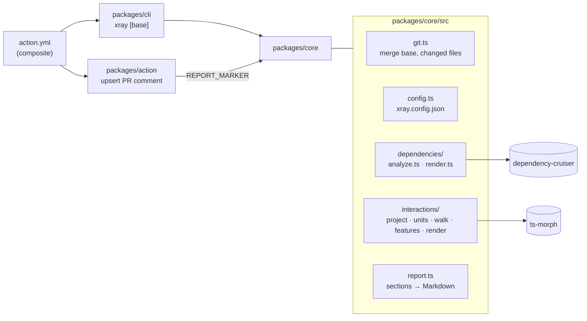

# Architecture

How xray is built. It explains *how* things work. The rules that follow from it are in
[principles.md](principles.md), the reasons for each choice in
[decisions.md](decisions.md), the security surface in [security.md](security.md), and open
work in [tasks.md](tasks.md). When code and this file disagree, the code is right and this
file is a bug.

## Shape

An npm workspaces monorepo in TypeScript (ESM, `NodeNext`), Node 24. It ships as:

- **`@xray/core`**: a library. Entry point `analyzePullRequest({ cwd, base })` → `XrayResult`;
  `renderMarkdown(result)` → the report.
- **`@xray/cli`**: the `xray [base]` binary (`packages/cli/src/index.ts`, commander).
- **A composite GitHub Action** (`action.yml` at the repo root) that builds the workspace in
  `github.action_path`, runs the CLI and calls `packages/action/dist/index.js` to post the comment.

## Modules

| Path | Owns |
|---|---|
| `packages/core/src/git.ts` | Resolving the merge base (`<base>` or `origin/<base>`), the changed files and changed line ranges (diff to the working tree + untracked files, relative to the analysed folder), and file contents on the base |
| `packages/core/src/config.ts` | `xray.config.json` loading and defaults (`roots`, `tsConfig`, `exclude`, `dependencies.*`, `interactions.*`) |
| `packages/core/src/dependencies/` | Analysis 1: cruise the project, keep changed modules + direct neighbours, render the Mermaid flowchart |
| `packages/core/src/interactions/project.ts`, `workspaces.ts` | Loading the ts-morph project: the root tsconfig, or every workspace package at a workspace root, with workspace package names resolved to source |
| `packages/core/src/interactions/units.ts` | Units: top-level functions, components, hooks, classes and lookup tables, found per file and by enclosing node |
| `packages/core/src/interactions/walk.ts` | Classifying references (renders, uses, calls, lazy-loads, mounts) and walking callers up and callees down |
| `packages/core/src/interactions/features.ts`, `analyze.ts` | The feature map, and grouping touched units into features (map features, entry points, shared hubs) |
| `packages/core/src/interactions/render.ts` | The Interactions section: table, sequence diagrams, warnings |
| `packages/core/src/testing/` | Test-only helpers (a throwaway git repository); not built |
| `packages/core/src/report.ts` | `ReportSection`, the hidden `<!-- xray:report -->` marker, the report frame |
| `packages/core/src/index.ts` | `analyzePullRequest`, `reportSections`, `renderMarkdown` and re-exports |
| `packages/cli/src/index.ts` | Argument parsing, `--format markdown|json`, `--out` |
| `packages/action/src/` | Reading the PR number from `GITHUB_EVENT_PATH`, finding/updating the comment via the REST API, truncating to 65 536 chars |
| `.github/workflows/` | `ci.yml` (build + tests) and `xray.yml` (runs the Action on this repo's PRs) |

## Data flow

1. `resolveMergeBase` finds the commit the branch forked from; `getChangedFiles` lists what changed
   since then (`git diff --name-status -M` + `git ls-files --others`).
2. `analyzeDependencies` cruises the configured `roots` once with dependency-cruiser (using the
   repo's tsconfig for path aliases), normalises every path to repo-relative POSIX, and builds the
   module graph. Type-only and dynamic imports are kept as edge flags; npm/Node modules are dropped
   unless `includeExternal`.
3. `selectNeighbourhood` keeps the changed modules plus whatever they import and whatever imports
   them, only edges touching a changed module, capped at `maxNodes` (neighbours touching more
   changed modules win). Changed files that are not graph modules go to `outsideGraph`.
4. `analyzeInteractions` skips everything when no code changed. Otherwise it loads one ts-morph
   project ([ADR-0004](docs/adr/0004-interactions-analysis.md)), finds the units whose lines the
   diff touches (`getChangedLines`), and compares unit names with the base (`git show`) to mark
   new and removed units. From each touched unit it walks callers up until an entry point (feature
   map, `entryGlobs`, a hub when there's no map ([ADR-0005](docs/adr/0005-interactions-refinements.md)),
   or nothing else using it) and callees down
   `depthDown` levels. Touched units are grouped into features: the map's, or one per entry point.
   Tests and stories never count as callers.
5. `reportSections` renders each analysis to a section; `renderReport` adds the marker and header.
6. In CI, the Action runs the CLI with `--head` set to the PR's head commit (the checkout itself is
   GitHub's temporary merge commit), writes the report to `$RUNNER_TEMP`, appends it to the job
   summary, and the comment script PATCHes the existing comment carrying the marker or POSTs a new one. A 403/404
   from the API (read-only token on fork PRs) is a warning, not a failure.

No state is kept between runs other than the PR comment itself.

## Build, test, deploy

- `tsc -b` with project references (`packages/{core,cli,action}/tsconfig.json` extend
  `tsconfig.base.json`). `typescript` stays on 6.x for dependency-cruiser
  ([ADR-0002](docs/adr/0002-typescript-6-for-dependency-cruiser.md)).
- Tests: vitest, `packages/*/src/**/*.test.ts`. Unit tests for parsing, neighbourhood selection
  and comment truncation; an integration test that builds a temporary git repo with a feature
  branch and runs `analyzePullRequest` end to end.
- CI: `.github/workflows/ci.yml` runs `npm ci`, build and tests on pushes to `main` and on PRs.
- Release: none yet. Consumers reference the Action by git ref; it builds itself on each run
  instead of shipping a committed `dist/`
  ([ADR-0003](docs/adr/0003-action-builds-at-runtime.md)).
