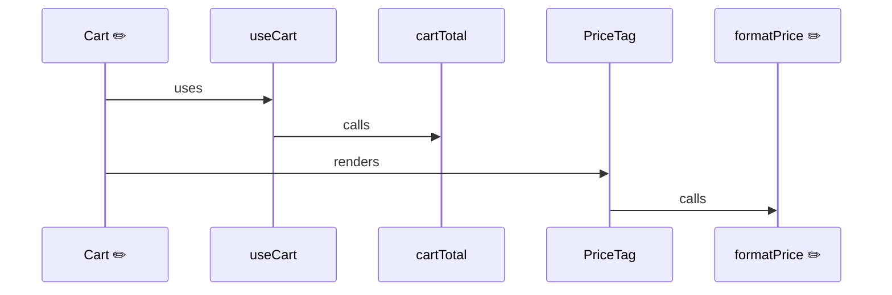

# 0004. Interactions analysis: ts-morph walk, feature map and sequence diagrams

- **Date:** 2026-11-01
- **Status:** Proposed

## Context

Analysis 2 answers "which user-facing features does this PR touch, and how does the change get
called?". The spec: find the functions and components touched by the diff with ts-morph, follow
references up to entry points (routes, components, handlers) and 1-2 levels down, and draw one
Mermaid sequence diagram per feature, using a feature map JSON versioned in the repo, generated
once with Claude and updated incrementally.

A throwaway spike (2026-11-01) tried this on two projects:

- **pearpages/dummy PR #3** (14 files): found the 4 touched units, walked up through renders,
  hook calls and a lazy `import()` to `App`, and 2 levels down (`Cart → useCart → cartTotal`).
  ~100 ms to load, ~100 ms to walk.
- **futbol-manager, commit 6f2e08e** (`packages/app`, 92 files, a 31-file a11y sweep): 17 touched
  units, ~170 ms to load, **~2 s** to walk (`findReferences` dominates). It exposed three gaps:
  1. Screens are mounted through a lookup table (`const SCREENS = { player: PlayerScreen }`), not
     JSX, so following only renders and calls made every screen look like an entry point.
  2. Test helpers (`openTable` in `App.test.tsx`) showed up as entry points.
  3. A sweep touching 17 units would produce ~10 diagrams: too many for one comment.

The spike also compared import graphs on futbol-manager: ts-morph and dependency-cruiser agree on
every TypeScript import (282 edges); dependency-cruiser also has the 20 CSS imports, ts-morph also
sees files outside the scanned roots. ts-morph took ~0.5 s against ~0.17 s.

## Decision

### Engine

- A new module `packages/core/src/interactions/` loads one ts-morph `Project` from the repo's
  tsconfig. Analysis 1 stays on dependency-cruiser ([ADR-0002](0002-typescript-6-for-dependency-cruiser.md)):
  the graphs agree, dependency-cruiser keeps CSS imports and is ~3× faster, so switching buys
  nothing yet.

### What is a unit

- A **unit** is a top-level named function, class, or `const` whose initialiser is a function or a
  call (`memo(...)`, `lazy(...)`, `forwardRef(...)`, HOCs). Identified as `path#name`.
- A unit is **touched** when the diff's added/changed lines (new side) overlap it. Units only in
  the base (deleted) are listed, not drawn.
- **Test files are excluded** from the walk (same pattern as analysis 1: `*.test.*`, `*.spec.*`,
  `__tests__/`). Tests are input for analysis 3, not callers.

### Relations (arrows)

| Relation | Detected from |
|---|---|
| `renders` | JSX `<X />` |
| `uses` | call of a `use*` function (hooks) |
| `calls` | any other call |
| `lazy-loads` | `import("./X")` resolving to the unit's file |
| `mounts` | the unit passed as a value (object/array literal, prop, argument): route tables, screen registries, `element`/`Component` route config, event handlers |

### Walking

- **Up**, from each touched unit, through references (imports skipped) until an **entry point**
  or 6 levels. Entry points, in priority order:
  1. the `entryPoints` of a feature in the feature map;
  2. units in files matching `interactions.entryGlobs` (defaults cover common layouts:
     `src/main.tsx`, `src/pages/**`, `src/routes/**`, `src/screens/**`, `app/**/page.tsx`,
     `app/**/route.ts`, `pages/**`);
  3. a unit nothing else references.
  Stopping at the first entry point keeps each path short.
- **Down**, from each touched unit, 2 levels (`interactions.depthDown`), following the same
  relations into project code only (no `node_modules`, no `.d.ts`).

### Feature map

- File `xray.features.json` at the analysed root, committed:

  ```json
  {
    "version": 1,
    "features": [
      { "id": "cart", "name": "Cart", "description": "See and pay for what you added",
        "entryPoints": ["src/pages/Cart.tsx#default"], "files": ["src/pages/Cart.tsx", "src/hooks/useCart.ts"] }
    ]
  }
  ```

- **The CLI only reads and validates it.** Generating and updating it is the job of the planned
  Claude skill (it reads the code and writes the file for review in a PR). xray never calls an AI
  API, so CI stays offline, deterministic and free.
- "Updated incrementally": when a PR touches units or entry points no feature covers, the section
  lists them under *Not in the feature map* so the skill (or a person) can add them.
- **Without a map**, each entry point reached is its own feature, named after the unit.

### Output

- Section `🔀 Interactions`: a table of affected features (name, touched units, entry point),
  then one `sequenceDiagram` per feature. Participants are units in first-call order; messages are
  ordered by a depth-first walk from the entry point in source order. Mermaid can't colour single
  participants, so touched ones carry a marker in their label (`formatPrice ✏️`, new units `🆕`).
- Limits: at most `interactions.maxDiagrams` (default 5) diagrams, the first open and the rest in
  `<details>`; features beyond the limit stay in the table. More than
  `interactions.maxTouchedUnits` (default 40) touched units skips the diagrams and shows only the
  table, so a sweep stays readable and fast.
- `XrayResult.interactions` carries features, units, relations and the walk, as data
  (principle P2).

### Example (dummy PR #3, with a map that has *Catalogue* and *Cart*)



## Open questions (to settle before Accepted)

1. ~~Who generates the feature map?~~ **Decided 2026-11-01: the Claude skill only** (see *Feature
   map*). Calling the Claude API from xray was rejected: it needs a secret in every consumer repo,
   costs per PR, doesn't work on fork PRs, and makes reports vary between runs. An opt-in API step
   could be a future ADR.
2. **No map:** draw diagrams per entry point (proposed), or show only the table plus a hint to
   create the map?
3. **Monorepos** (futbol-manager's `packages/*`): v1 analyses one tsconfig (the Action's
   `working-directory`); references into other workspace packages stop there. Good enough?

## Consequences

+ Reviewers see which features a PR reaches and through which path, not just which files.
+ The feature map gives diagrams human names and stops walks early, keeping them small.
+ No AI call in CI; the map is reviewed like code.
− ts-morph adds ~13 MB to the Action's install; per principle P6 it is re-measured on dummy before
  shipping ([ADR-0003](0003-action-builds-at-runtime.md)).
− `findReferences` costs ~2 s on a 31-file PR in a 92-file app; larger repos need the
  `maxTouchedUnits` guard and a measurement before shipping.
− Static analysis misses dynamic dispatch (string keys, `props.render()`, context-provided
  functions); diagrams show what the code states, not every runtime path.
− Two parsers in the project (dependency-cruiser for analysis 1, ts-morph for 2) until ADR-0002 is
  revisited.
