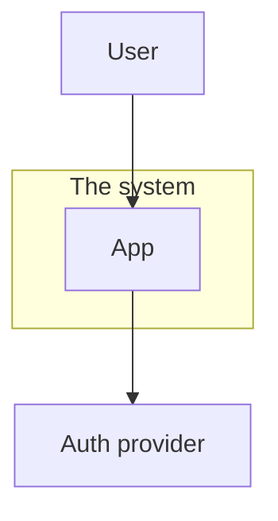
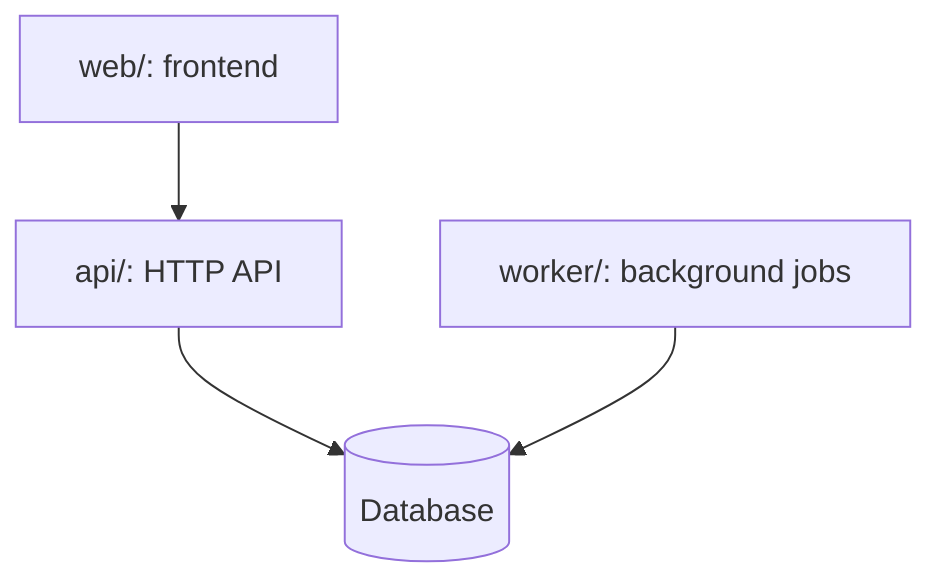
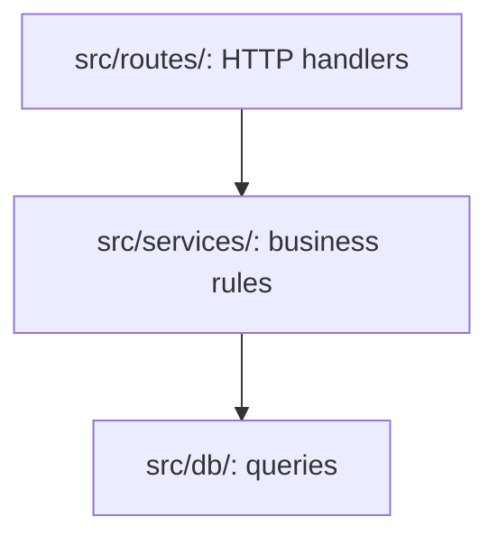

# Code maps: rules for the plugin's diagrams

How the xray skills draw and check **code maps**: diagrams of how a codebase fits together (what
surrounds it, its deployable pieces, the building blocks inside one of them, where it runs). It
also covers the one diagram `/xray:onboard` draws per hotspot. The rules hold for any language.

Output is always a bare ` ```mermaid ` fence: it renders on GitHub, GitLab, VS Code and most
docs tools, with no theme or config assumed.

## Which map answers which question

C4 is a shared vocabulary of zoom levels for the *same* system: **Context**, **Container**,
**Component** (and Code, which these skills never draw). One diagram per level, like a map
going from country to street.

| Question | Map | Draw it when the repo shows |
|---|---|---|
| What users and external systems surround this? | C4 Context | always |
| What are the deployable pieces? | C4 Container | more than one deployable, or a database, cache or queue |
| What are the building blocks inside, and which way do dependencies point? | C4 Component | one app, a package, or a folder in scope |
| Where and how does it run? | Deployment | a Dockerfile, CI workflows, infrastructure as code |

Where the evidence comes from:

- **Context and Container**: README, docs, ADRs, package manifests (`package.json`,
  `pyproject.toml`, `go.mod`, `Cargo.toml`…), entry points, `docker-compose*`, environment
  variables naming external services.
- **Component**: the imports. On a TypeScript/JavaScript repo, take them from xray's import graph
  (`xray.sh quality -f graph`): group modules into components by folder, draw an arrow between
  two components only when a non-type-only edge joins them, and never draw one the graph doesn't
  have. In other languages, read the import lines and say the arrows are read by hand.
- **Deployment**: CI workflows, Dockerfiles, IaC (`*.tf`, `k8s/`, `serverless.yml`…).

No evidence, no diagram. When a part isn't in the code (a planned design, a flow in another
system), ask the user instead of guessing.

## Rules for every diagram

- **One question per diagram**, named in the heading above it ("What are the deployable
  pieces?", never "Complete architecture"), with one plain sentence under the heading saying
  what the diagram shows.
- **One real-world thing is exactly one node.** Two nodes with the same label read as two
  things. A thing that both gives and receives gets one node with arrows both ways.
- **An arrow means "uses"** (calls, imports, reads from) unless its label says otherwise:
  `A -->|writes| B`.
- **Top to bottom** (`flowchart TD`) for anything over about four nodes; `LR` only for short
  chains. A wide diagram shrinks to nothing on a phone.
- **Boundaries are `subgraph`s.** Use `flowchart` for C4, not Mermaid's `C4Context` type,
  which renders poorly.
- **Quote labels** with punctuation: `api["api/: routes (REST)"]`. Expand acronyms on first use.
- **Name real files and folders in component labels** (`deps["dependencies/graph.ts: cruise"]`),
  so `/xray:check-diagrams` can check the map against the code later.
- When a diagram gets noisy, split it, or use a table.

## Templates

Replace the placeholder nodes with what the repo shows.







## One diagram per hotspot

`/xray:onboard` explains each hard part with the one diagram that fits the difficulty:

| The difficulty is… | Draw | Mermaid |
|---|---|---|
| a step-by-step flow across parts | Sequence | `sequenceDiagram`: solid `->>` is a call, dashed `-->>` its reply |
| a thing with a lifecycle | State | `stateDiagram-v2` |
| a branching rule | Flowchart | `flowchart TD`, decisions as `{diamonds}` |
| async fan-out | Event flow | `flowchart`, events on the labelled edges |
| too noisy to draw | Decision table | a Markdown table |
